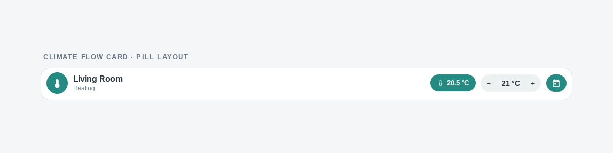

<div align="center">

# Climate Flow Card

### A climate card with an optional persistent weekly schedule for Home Assistant.

[](https://www.home-assistant.io/) · [MIT License](LICENSE)

</div>

**Climate Flow Card** (`custom:climate-flow-card`) provides `pill` and `compact` layouts. The optional scheduler runs in the integration backend and persists across restarts.



Preview only: sample entity data; not captured from a live Home Assistant instance.

## Install

Install through HACS as a **custom repository**: add `https://github.com/kerdx/climate-flow-card` with category **Integration**, install **Climate Flow Scheduler**, and restart Home Assistant. Then add the integration under **Settings → Devices & services → Add integration** and add **Climate Flow Card** to a dashboard. The integration registers the card automatically; no Lovelace resource is needed.

Minimum Home Assistant version: **2025.1**. For manual installation, copy `custom_components/climate_flow_scheduler` into `config/custom_components/`, restart, and add the integration.

### Card not in the card picker

The card is loaded by the integration itself, so it only exists once the integration is set up:

1. Check that **Climate Flow Scheduler** is listed and loaded under **Settings → Devices & services**. Installing the files alone registers nothing, because no config entry means `async_setup` never runs.
2. Reload the Home Assistant page in the browser (hard reload: `Ctrl`/`Cmd` + `Shift` + `R`). The frontend index is served once per page load, so a tab opened before the integration was added does not include the card module.
3. Verify the asset is served: open `https://<your-ha>/climate_flow_scheduler/climate-flow-card.js` in a browser tab. A 404 means the integration is not loaded; a JavaScript error means the module failed to parse.
4. Open the browser console on a dashboard: `window.customCards` must contain an entry with `type: "climate-flow-card"`. Card picker registrations only appear if the module was loaded before the picker dialog was opened.

## Card configuration

```yaml
type: custom:climate-flow-card
entity: climate.living_room
layout: pill # or compact
# Optional look, both set from the card editor as well:
# accent_color: "#3f9cf4" # accent for icon, chips, slider and calendar button; remove it to follow the theme again
# surface: default # default | elevated (contrast and depth) | blend (no background, for dark dashboards)
# main_temperature: target # target | current: which temperature takes the prominent slot
# show_entity_picture: false # replace the circular icon with the entity picture
# language: auto # auto | en | it: fixes the card language independently of the interface
# Optional background actions (the default tap still toggles heating off/on):
# tap_action: toggle # toggle | more-info | none
# hold_action: none # toggle | more-info | none (long press)
# double_tap_action: none # toggle | more-info | none
```

No legacy card-tag or layout aliases are supported.

## Scheduler

The backend scheduler is optional and stores one program per climate entity. Programs contain non-overlapping slots with weekdays, Home Assistant local start/end times, and target temperatures. An optional `hvac_mode` can be applied both during and outside slots. An optional outside-schedule temperature sets a target outside slots; if it is absent, no target is sent outside slots, even though the configured HVAC mode still applies there.

Manual target changes can create a temporary override (30 minutes, 1 hour, 2 hours, or until the next schedule boundary); **Resume schedule** clears it immediately.

A program can also be paused for a vacation: `set_pause` holds one target for 1, 3, 7, 14, or 30 days and the weekly program resumes automatically when the pause expires. Pauses survive a restart, a temporary manual override still wins over the pause, and **Resume schedule** / `resume_program` clears both the override and the pause. The card exposes the pause in its schedule dialog, and the diagnostic sensor reports it as `pause` (`target`, `until`).

Breaking rename: old integration entries, service calls, and stored schedules are not migrated. Services use the `climate_flow_scheduler` domain: `save_program`, `set_enabled`, `delete_program`, `set_manual_override`, `set_pause`, and `resume_program`.

## Development

- JavaScript tests: `npm test`
- Python tests: `python3 -m unittest discover -s tests_backend`

See [issues](https://github.com/kerdx/climate-flow-card/issues) for bug reports and feature requests.
